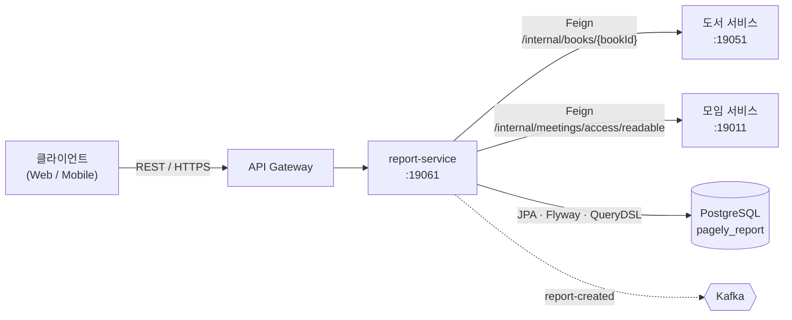
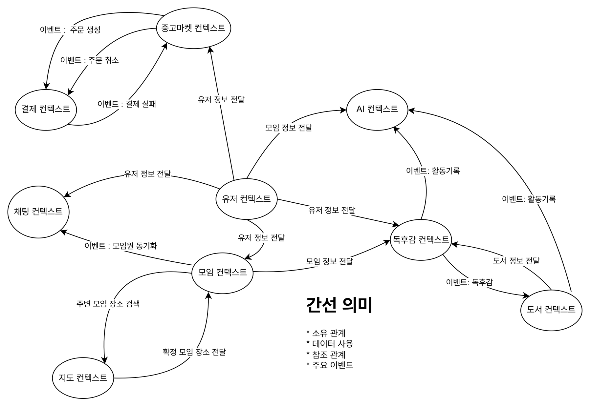
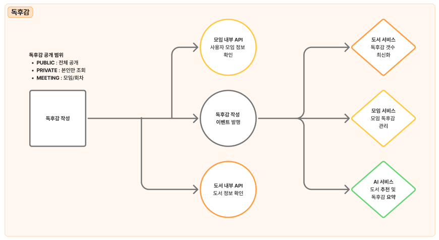
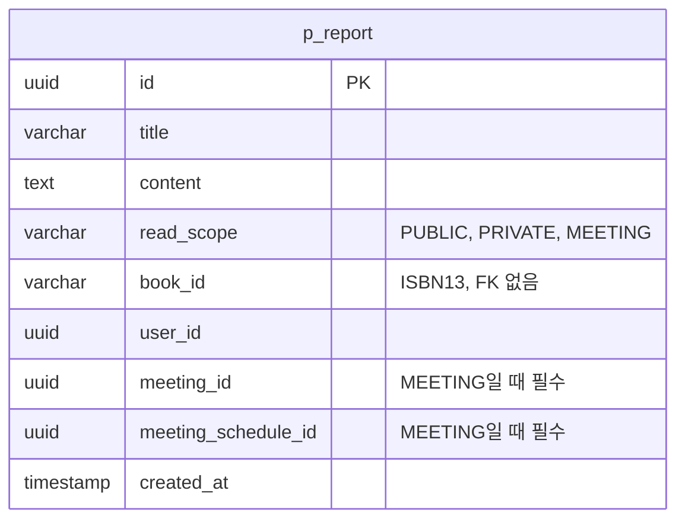

# report-service

Pagely의 독후감 서비스입니다. 독후감을 작성하고, 공개 범위(전체 공개·본인만·모임/회차)에 따라 볼 수 있는 독후감 목록을 조회합니다. 독후감이 만들어지면 `report-created` 이벤트를 Kafka로 발행합니다.

> Pagely는 독서 모임, 중고 거래, AI 추천이 이어지는 MSA 기반 독서 플랫폼입니다. 이 저장소는 그중 독후감 도메인만 담습니다.

## 담당 범위

Pagely 팀 프로젝트(6명)에서 독후감 도메인을 맡아 이 서비스를 개발했습니다.

| 영역 | 내용 |
| --- | --- |
| API | 독후감 작성, 공개 범위별 목록 조회 (2개 엔드포인트) |
| 공개 범위 | `PUBLIC`·`PRIVATE`·`MEETING` 규칙을 도메인 검증과 DB 제약 두 곳에서 지킵니다. |
| 서비스 간 연동 | OpenFeign으로 도서 서비스(도서 확인)와 모임 서비스(참여 모임·회차 확인)를 호출하고, 사용자 헤더를 그대로 전달합니다. |
| 목록 조회 | QueryDSL로 공개 범위와 사용자가 속한 모임·회차를 조건으로 조회합니다. |
| 이벤트 | 도메인 이벤트와 Port-Adapter 구조로 `report-created`를 커밋 후 발행합니다. |
| 데이터 | Flyway로 관리하는 `p_report` 테이블 |
| 협업 | GitHub Actions PR 빌드, 브랜치 이름 검사, 리뷰어 자동 할당 설정 |

인증·응답·페이징 같은 공통 코드는 팀 공통 모듈(`com.pagely:common`)을 사용합니다.

## 시스템에서의 위치



실선은 동기 호출, 점선은 비동기 이벤트입니다. 서비스별로 DB를 따로 사용합니다. 도서 서비스는 [book-service](https://github.com/Pagely-wisely/book-service)입니다.

### 컨텍스트 맵


## 도메인 플로우



1. **독후감 작성**: 도서 서비스의 내부 API로 도서 정보를 확인합니다. 공개 범위가 `MEETING`이면 모임 서비스의 내부 API로 사용자가 해당 모임과 회차에 속하는지 확인합니다.
2. **저장과 이벤트 발행**: 독후감을 저장하고, 커밋 후 도서·독후감 정보를 담은 `report-created` 이벤트를 발행합니다.
3. **목록 조회**: 공개 범위 조건에 맞는 독후감을 최신순으로 페이지 단위로 조회합니다.

### 공개 범위

| 값 | 의미 | 조회할 수 있는 사람 |
| --- | --- | --- |
| `PUBLIC` | 전체 공개 | 모든 사용자 |
| `PRIVATE` | 본인만 조회 | 작성자 |
| `MEETING` | 모임/회차 공개 | 해당 모임과 회차에 속한 사용자 |

`MEETING`일 때만 `meetingId`와 `scheduleId`를 보냅니다. 다른 공개 범위에 모임 정보를 보내면 오류입니다.

## 설계 결정

| 결정 | 이유 |
| --- | --- |
| 공개 범위 규칙을 도메인과 DB에서 모두 검증 | `Report.create`가 공개 범위와 모임 정보의 조합을 검증하고, DB에는 `CHECK` 제약(`MEETING`이면 모임·회차 필수, 값은 세 가지만 허용)을 둡니다. 서비스 코드를 거치지 않는 경로가 생겨도 잘못된 데이터가 저장되지 않습니다. |
| 모임 접근 확인을 도메인 인터페이스(`MeetingChecker`) 뒤에 둠 | 도메인 모델이 모임 서비스의 호출 방식을 모릅니다. 구현은 `infrastructure/provider`가 Feign으로 합니다. |
| 사용자 헤더를 Feign 호출에 전달 | `X-User-Id`, `X-User-Role`을 요청 인터셉터가 복사해 도서·모임 서비스가 같은 사용자로 처리합니다. |
| 목록 조회는 QueryDSL 동적 조건 | 공개 범위를 지정하지 않으면 `PUBLIC` + 내 `PRIVATE` + 내가 속한 모임·회차의 `MEETING`을 합쳐 조회합니다. 속한 모임이 없으면 `MEETING` 조건은 항상 거짓입니다. |
| 커밋 후 이벤트 발행 | `@TransactionalEventListener(AFTER_COMMIT)`에서 Kafka로 보냅니다. 저장이 롤백되면 이벤트도 나가지 않습니다. |
| 이벤트에 도서 정보를 함께 담음 | `report-created` payload에 도서 ID·제목·카테고리·저자·설명과 독후감 내용을 포함합니다. |
| Kafka 메시지에 타입 헤더를 넣지 않음 | `spring.json.add.type.headers: false`로 JSON만 보냅니다. 소비하는 서비스가 발행 측 클래스 경로에 의존하지 않습니다. |
| Port-Adapter 구조 | 도서·모임 호출, Kafka, 영속성을 `application/port`와 `domain`의 인터페이스 뒤로 두고 `infrastructure`가 구현합니다. |

## API

모든 엔드포인트는 `MASTER`, `USER`, `CREATOR` 역할이 호출할 수 있습니다. 구분의 "외부"는 클라이언트용입니다.

| 구분 | 대상 | Method | Path | 설명 | 응답 |
| --- | --- | --- | --- | --- | --- |
| 외부 | 유저 | POST | `/api/v1/reports` | 독후감을 작성합니다. 도서를 확인한 뒤 저장하고 `report-created` 이벤트를 발행합니다. 작성 내역은 추천에 사용됩니다. | 200 |
| 외부 | 유저 | GET | `/api/v1/reports` | 독후감 목록을 피드 형태로 조회합니다. `readScope`(선택), `page`(기본 0), `size`(기본 10). 모임 독후감은 모임에 참가한 사용자인지 검증합니다. | 200 |

### 요청 · 응답

**독후감 작성** `POST /api/v1/reports`

| 필드 | 필수 | 설명 |
| --- | --- | --- |
| `title` | O | 제목, 255자 이내 |
| `content` | O | 내용 |
| `readScope` | O | `PUBLIC` · `PRIVATE` · `MEETING` |
| `bookId` | O | 도서 ID(ISBN13), 20자 이내 |
| `meetingId` | `MEETING`일 때 | 모임 ID |
| `scheduleId` | `MEETING`일 때 | 모임 회차 ID |

응답 데이터: `reportId`, `createdAt`

**독후감 목록 조회** `GET /api/v1/reports`

응답 항목: `id`, `title`, `content`, `readScope`, `bookId`, `userId`, `meetingId`, `scheduleId`, `createdAt` (최신순, 페이지 응답)

### 에러 응답

| 코드 | HTTP | 메시지 | 발생 조건 |
| --- | --- | --- | --- |
| `READ_SCOPE_MISMATCH` | 400 | 공개 범위가 잘못 설정됐습니다. | `MEETING`이 아닌데 모임 정보를 보냄, `MEETING`인데 `meetingId`가 없음 |
| `MEETING_INVALID` | 400 | 잘못된 모임 정보입니다. | `MEETING`인데 `scheduleId`가 없음 |
| `USER_NULL` | 400 | 사용자 정보가 비어있습니다. | 사용자 ID가 없음 |
| `MEETING_ACCESS_FORBIDDEN` | 403 | 해당 모임에 접근 권한이 없습니다. | 사용자가 해당 모임·회차에 속하지 않음 |
| `BOOK_NOT_FOUND` | 404 | 도서 정보가 존재하지 않습니다. | 도서 서비스에서 도서를 찾을 수 없음 |

## 이벤트 (Kafka 발행)

| 토픽 | 발행 시점 | 키 |
| --- | --- | --- |
| `report-created` | 독후감 저장 커밋 후 | reportId |

payload: `bookId`, `bookName`, `bookCategory`, `bookAuthors`, `bookDescription`, `userId`, `reportId`, `reportContent`, `meetingId`, `meetingScheduleId`, `createdAt`

## 데이터 모델



스키마는 Flyway(`src/main/resources/db/migration/V1__init.sql`)가 관리하고, JPA는 `ddl-auto: validate`로 검증만 합니다. 다른 서비스의 도서·모임·사용자는 ID로만 참조하고 FK를 두지 않습니다. `deleted_at` 기반 소프트 삭제 컬럼을 가집니다.

## 기술 스택

Java 21 · Spring Boot 3.5 · Spring Cloud 2025.0 (OpenFeign, Eureka Client) · Spring Data JPA · QueryDSL · Flyway · PostgreSQL · Kafka · GitHub Actions

## 프로젝트 구조

```
src/main/java/com/pagely/reportservice
├── presentation     # REST 컨트롤러, 요청·응답 DTO
├── application      # 서비스, 커맨드·쿼리·결과 DTO, port.out 인터페이스
├── domain           # 엔티티, 공개 범위, 리포지토리·MeetingChecker 인터페이스, 도메인 이벤트, 예외
└── infrastructure   # Feign 클라이언트, JPA·QueryDSL·Kafka·Spring 이벤트 어댑터
```

## 실행 방법

### 준비물
- JDK 21
- PostgreSQL (데이터베이스 `pagely_report`)
- Kafka (기본 `localhost:9092`)
- 실행 중인 도서 서비스(`localhost:19051`)와 모임 서비스(`localhost:19011`). 독후감 작성과 목록 조회가 두 서비스를 호출합니다.
- GitHub Packages 읽기 토큰. 공통 라이브러리 `com.pagely:common`을 `maven.pkg.github.com/Pagely-wisely/common`에서 받습니다. 토큰은 `GPR_USER`, `GPR_KEY` 환경변수 또는 Gradle 속성 `gpr.user`, `gpr.key`로 전달합니다.

### 설정
`src/main/resources/.env`를 만듭니다. 이 파일은 `.gitignore`에 포함되어 있습니다. 서비스 공통 `.env`를 그대로 써도 되고, 이 서비스는 아래 항목만 읽습니다. `.env.example`을 참고하세요.

```properties
DB_HOST=localhost
DB_PORT=5432
REPORT_DB_NAME=pagely_report
DB_USERNAME=<DB 사용자>
DB_PASSWORD=<DB 비밀번호>
```

도서·모임 서비스 주소를 바꾸려면 `application.yml`의 `api.internal.book-service`, `api.internal.meeting-service`를 수정하거나 실행 인자로 덮어씁니다.

### 실행
```bash
export GPR_USER=<GitHub 사용자명>
export GPR_KEY=<read:packages 권한 토큰>

./gradlew bootRun
```

- 서버 포트는 `19061`입니다.
- 테이블은 첫 실행 때 Flyway가 만듭니다. 데이터베이스는 미리 만들어 두어야 합니다.
- Eureka 등록은 `register-with-eureka: false`로 꺼져 있습니다.

### 호출 예시
인증 정보는 `X-User-Id`, `X-User-Role` 헤더로 전달합니다.

```bash
curl -X POST 'http://localhost:19061/api/v1/reports' \
     -H 'Content-Type: application/json' \
     -H 'X-User-Id: 00000000-0000-0000-0000-000000000001' \
     -H 'X-User-Role: USER' \
     -d '{"title":"제목","content":"내용","readScope":"PUBLIC","bookId":"9788925588735"}'

curl -G 'http://localhost:19061/api/v1/reports' \
     -H 'X-User-Id: 00000000-0000-0000-0000-000000000001' \
     -H 'X-User-Role: USER' \
     --data-urlencode 'readScope=PUBLIC'
```

### 테스트
```bash
./gradlew test
```
테스트는 H2(PostgreSQL 모드)를 사용하고 Flyway는 끕니다. `main`, `dev` 대상 PR마다 GitHub Actions가 PostgreSQL 16 서비스와 함께 `./gradlew clean build`를 실행합니다.
